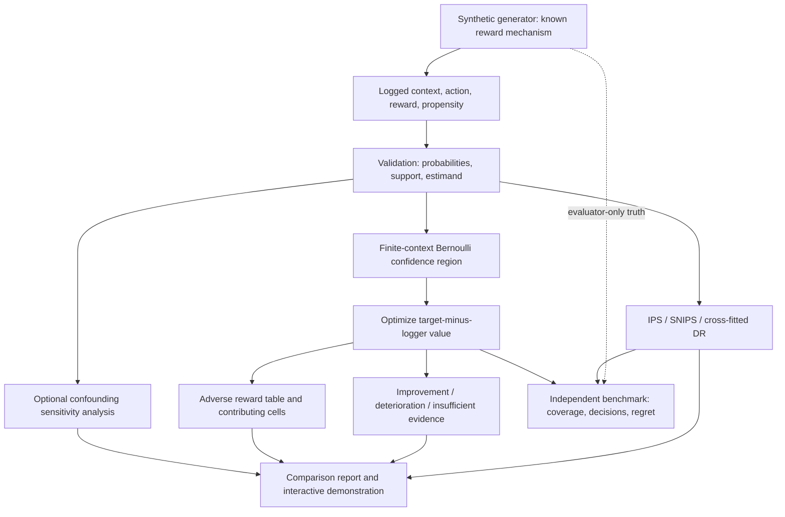

# Optional architecture: counterfactual evaluation with decision certificates

**Data boundary:** Estimators receive logged chosen-action rewards only. Counterfactual truth is restricted to simulation and benchmark scoring.

**Scope boundary:** The certificate engine requires a fixed sufficient context partition, Bernoulli rewards and a declared target context distribution. Applying it to arbitrary coarsened real-world features does not automatically preserve causal validity.

**Decision boundary:** A positive lower bound supports improvement under those assumptions. A negative upper bound supports deterioration. Otherwise, the report shows the uncertainty interval and an adverse feasible model where available. The model is not asserted to be the true world.

**Build order:** Standard OPE and reversal demo → tested certificate solver → counterexample display → sensitivity analysis → optional public-data replication.
