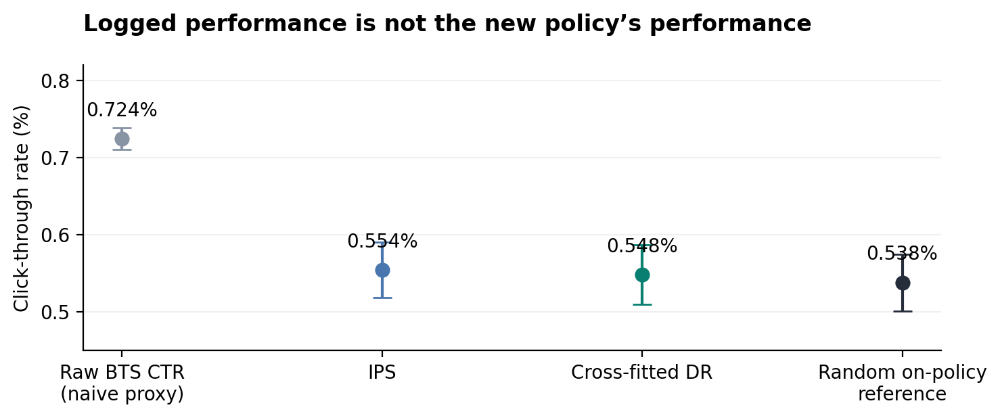
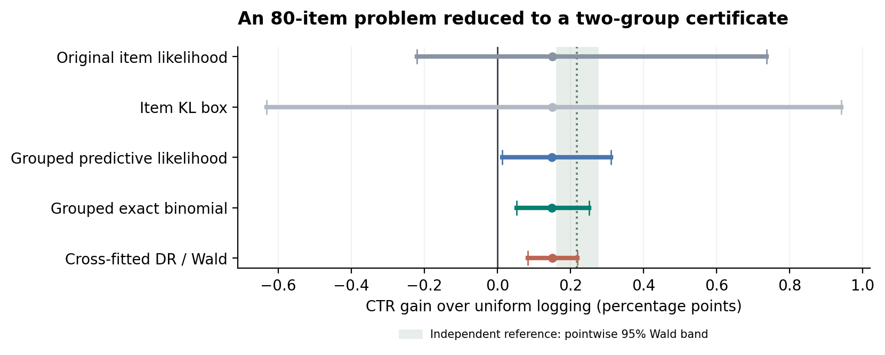
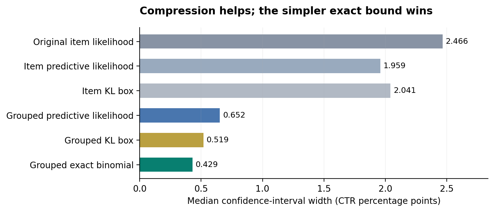
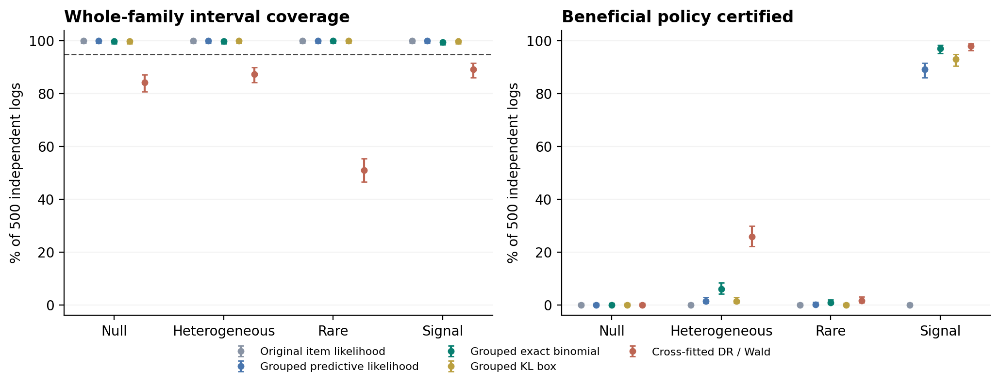
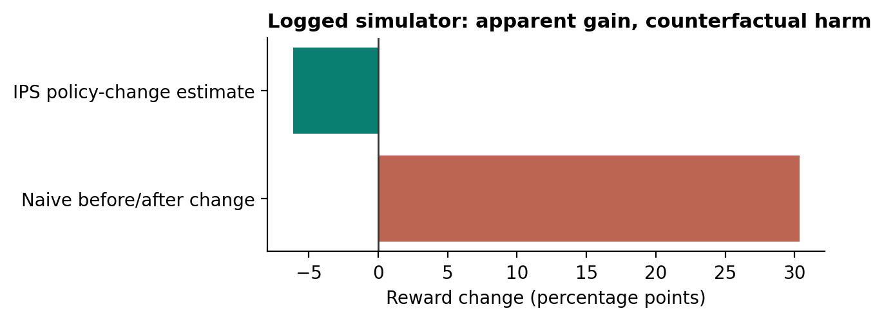

# Results: policy-aware compression on Open Bandit Dataset

The strongest practical result is the reduction to the policy comparison’s required reward groups. The proposed predictive-mixture likelihood improved on the earlier item-level procedure, but did not outperform the grouped exact-binomial baseline overall. The recommended implementation is therefore grouped exact inference, with likelihood methods retained as audited alternatives. This is an application extension, not a validated world-first algorithm.

## Data and storage

Processed 6,769,588 rows from four full campaign files in the official ZOZO archive. Retrieved members occupy 93.85 MiB; compact arrays approximately 34.73 MiB. The 160 GB warning on ZOZO’s page concerns SHIFT15M, not OBD. No full CSV extraction was needed.

Primary analysis: Random/all, first position, 80 items. Pilot/certification/reference counts are 91,674, 183,450, 182,881. Other campaigns and chronological splits are reported below. Observations from matching exact timestamps stay in the same split. This does not establish independence of repeated users.

## Standard OPE: BTS men to uniform Random

BTS observations: 1,358,878; independent Random reference observations: 150,936, both first position. Logged BTS CTR is 0.7245%; IPS estimates Random CTR at 0.5542%; cross-fitted tabular DR gives 0.5481%; observed Random reference is 0.5380%.
Relative discrepancy from this empirical reference is 34.67% for reusing BTS CTR and 1.89% for DR. These are empirical point-estimate discrepancies, not errors against exact ground truth or evidence that DR beats IPS significantly. The raw BTS mean is a naive target-policy proxy, not a before/after causal estimator.
Maximum importance weight: 5882.4; weight ESS: 6808.6. Supplied BTS propensities are Monte Carlo approximations. Cross-fitting uses a smoothed action-level reward model and known logged propensities; it is not a rich personalized reward model.

## Primary extension result

Across all five prespecified candidate sizes, grouped exact bounds reduce interval width by a median 82.59% against the original item-level likelihood and 78.97% against item-level KL boxes. Predictive likelihood alone achieves a 73.55% median reduction against the original. All these are within the same fixed primary split.
The grouped-exact selector chooses k=20. Its family-corrected interval is [0.0528, 0.2515] CTR percentage points. Independent reference gain: 0.2184 points, with pointwise 95% Wald interval [0.1618, 0.2750]. These refer to sampling uncertainty under their respective assumptions; reference outcomes are not used to tune the policy or interval.

| Method | Median width (pp) | Candidates certified / 5 |
|---|---:|---:|
| Original item likelihood | 2.4656 | 0 |
| Grouped split likelihood | 0.8693 | 0 |
| Item predictive likelihood | 1.9589 | 0 |
| Grouped predictive likelihood | 0.6521 | 1 |
| Item Jeffreys mixture | 4.4670 | 0 |
| Grouped Jeffreys mixture | 0.7226 | 1 |
| Item KL box | 2.0414 | 0 |
| Grouped KL box | 0.5191 | 1 |
| Grouped exact binomial | 0.4292 | 1 |
| IPS / Wald | 0.3302 | 2 |
| Cross-fitted DR / Wald | 0.3293 | 2 |

The narrower Wald intervals are asymptotic; their nominal coverage must be checked independently rather than inferred from width.

## Replication and chronological stress

| Campaign / split | Grouped exact: certified candidates | Predictive likelihood: certified candidates |
|---|---:|---:|
| all / chronological | 2 | 0 |
| all / random | 1 | 1 |
| men / chronological | 0 | 0 |
| men / random | 1 | 0 |
| women / chronological | 0 | 0 |
| women / random | 3 | 1 |

Chronological results concern different time populations and are not IID-coverage experiments. The predictive method certifies no candidate on any chronological split; grouped exact certifies two only on all. This limits any broad deployment claim. Reference and certification 15-minute block-bootstrap diagnostics are stored in each JSON; they do not remove hidden user dependence or guarantee transport to future traffic.

## Synthetic truth and calibration

16 frozen cases x 500 independent logs = 8,000 logs; 11 methods = 88,000 method-trial records. Policies are relearned using each trial’s independent pilot. Whole-family coverage means every candidate gain is inside its interval. Beneficial certification is a decision metric, not interval coverage. Wilson intervals in the calibration figure quantify Monte Carlo uncertainty for each 500-log case.

| Actions | Total n | Design | Method | Family coverage | False improvement | Beneficial certified | Mean selected gain |
|---:|---:|---|---|---:|---:|---:|---:|
| 20 | 10000 | null | dr_wald | 375/500 | 7/500 | 0/500 | 0.000000 |
| 20 | 10000 | null | group_exact | 500/500 | 0/500 | 0/500 | 0.000000 |
| 20 | 10000 | null | group_jeffreys | 500/500 | 0/500 | 0/500 | 0.000000 |
| 20 | 10000 | null | group_kl | 500/500 | 0/500 | 0/500 | 0.000000 |
| 20 | 10000 | null | group_predictive | 500/500 | 0/500 | 0/500 | 0.000000 |
| 20 | 10000 | null | group_split | 500/500 | 0/500 | 0/500 | 0.000000 |
| 20 | 10000 | null | ips_wald | 376/500 | 6/500 | 0/500 | 0.000000 |
| 20 | 10000 | null | item_jeffreys | 500/500 | 0/500 | 0/500 | 0.000000 |
| 20 | 10000 | null | item_kl | 500/500 | 0/500 | 0/500 | 0.000000 |
| 20 | 10000 | null | item_predictive | 500/500 | 0/500 | 0/500 | 0.000000 |
| 20 | 10000 | null | item_split | 500/500 | 0/500 | 0/500 | 0.000000 |
| 20 | 10000 | heterogeneous | dr_wald | 432/500 | 0/500 | 48/500 | 0.000134 |
| 20 | 10000 | heterogeneous | group_exact | 500/500 | 0/500 | 2/500 | 0.000006 |
| 20 | 10000 | heterogeneous | group_jeffreys | 500/500 | 0/500 | 0/500 | 0.000000 |
| 20 | 10000 | heterogeneous | group_kl | 500/500 | 0/500 | 0/500 | 0.000000 |
| 20 | 10000 | heterogeneous | group_predictive | 500/500 | 0/500 | 3/500 | 0.000010 |
| 20 | 10000 | heterogeneous | group_split | 500/500 | 0/500 | 4/500 | 0.000015 |
| 20 | 10000 | heterogeneous | ips_wald | 426/500 | 0/500 | 47/500 | 0.000126 |
| 20 | 10000 | heterogeneous | item_jeffreys | 500/500 | 0/500 | 0/500 | 0.000000 |
| 20 | 10000 | heterogeneous | item_kl | 500/500 | 0/500 | 0/500 | 0.000000 |
| 20 | 10000 | heterogeneous | item_predictive | 500/500 | 0/500 | 0/500 | 0.000000 |
| 20 | 10000 | heterogeneous | item_split | 500/500 | 0/500 | 0/500 | 0.000000 |
| 20 | 10000 | rare | dr_wald | 283/500 | 0/500 | 4/500 | 0.000002 |
| 20 | 10000 | rare | group_exact | 500/500 | 0/500 | 0/500 | 0.000000 |
| 20 | 10000 | rare | group_jeffreys | 500/500 | 0/500 | 0/500 | 0.000000 |
| 20 | 10000 | rare | group_kl | 500/500 | 0/500 | 0/500 | 0.000000 |
| 20 | 10000 | rare | group_predictive | 500/500 | 0/500 | 1/500 | 0.000002 |
| 20 | 10000 | rare | group_split | 500/500 | 0/500 | 2/500 | 0.000002 |
| 20 | 10000 | rare | ips_wald | 269/500 | 0/500 | 4/500 | 0.000002 |
| 20 | 10000 | rare | item_jeffreys | 500/500 | 0/500 | 0/500 | 0.000000 |
| 20 | 10000 | rare | item_kl | 500/500 | 0/500 | 0/500 | 0.000000 |
| 20 | 10000 | rare | item_predictive | 500/500 | 0/500 | 0/500 | 0.000000 |
| 20 | 10000 | rare | item_split | 500/500 | 0/500 | 0/500 | 0.000000 |
| 20 | 10000 | signal | dr_wald | 422/500 | 1/500 | 233/500 | 0.003046 |
| 20 | 10000 | signal | group_exact | 500/500 | 0/500 | 176/500 | 0.003271 |
| 20 | 10000 | signal | group_jeffreys | 500/500 | 0/500 | 58/500 | 0.000929 |
| 20 | 10000 | signal | group_kl | 500/500 | 0/500 | 92/500 | 0.001647 |
| 20 | 10000 | signal | group_predictive | 500/500 | 0/500 | 162/500 | 0.002740 |
| 20 | 10000 | signal | group_split | 500/500 | 0/500 | 128/500 | 0.002389 |
| 20 | 10000 | signal | ips_wald | 420/500 | 1/500 | 231/500 | 0.002927 |
| 20 | 10000 | signal | item_jeffreys | 500/500 | 0/500 | 0/500 | 0.000000 |
| 20 | 10000 | signal | item_kl | 500/500 | 0/500 | 0/500 | 0.000000 |
| 20 | 10000 | signal | item_predictive | 500/500 | 0/500 | 2/500 | 0.000029 |
| 20 | 10000 | signal | item_split | 500/500 | 0/500 | 0/500 | 0.000000 |
| 20 | 50000 | null | dr_wald | 468/500 | 4/500 | 0/500 | 0.000000 |
| 20 | 50000 | null | group_exact | 500/500 | 0/500 | 0/500 | 0.000000 |
| 20 | 50000 | null | group_jeffreys | 500/500 | 0/500 | 0/500 | 0.000000 |
| 20 | 50000 | null | group_kl | 500/500 | 0/500 | 0/500 | 0.000000 |
| 20 | 50000 | null | group_predictive | 500/500 | 0/500 | 0/500 | 0.000000 |
| 20 | 50000 | null | group_split | 500/500 | 0/500 | 0/500 | 0.000000 |
| 20 | 50000 | null | ips_wald | 467/500 | 4/500 | 0/500 | 0.000000 |
| 20 | 50000 | null | item_jeffreys | 500/500 | 0/500 | 0/500 | 0.000000 |
| 20 | 50000 | null | item_kl | 500/500 | 0/500 | 0/500 | 0.000000 |
| 20 | 50000 | null | item_predictive | 500/500 | 0/500 | 0/500 | 0.000000 |
| 20 | 50000 | null | item_split | 500/500 | 0/500 | 0/500 | 0.000000 |
| 20 | 50000 | heterogeneous | dr_wald | 468/500 | 0/500 | 441/500 | 0.001839 |
| 20 | 50000 | heterogeneous | group_exact | 499/500 | 0/500 | 296/500 | 0.001266 |
| 20 | 50000 | heterogeneous | group_jeffreys | 500/500 | 0/500 | 84/500 | 0.000350 |
| 20 | 50000 | heterogeneous | group_kl | 500/500 | 0/500 | 170/500 | 0.000738 |
| 20 | 50000 | heterogeneous | group_predictive | 500/500 | 0/500 | 245/500 | 0.001048 |
| 20 | 50000 | heterogeneous | group_split | 499/500 | 0/500 | 136/500 | 0.000631 |
| 20 | 50000 | heterogeneous | ips_wald | 468/500 | 0/500 | 438/500 | 0.001830 |
| 20 | 50000 | heterogeneous | item_jeffreys | 500/500 | 0/500 | 0/500 | 0.000000 |
| 20 | 50000 | heterogeneous | item_kl | 500/500 | 0/500 | 0/500 | 0.000000 |
| 20 | 50000 | heterogeneous | item_predictive | 500/500 | 0/500 | 7/500 | 0.000029 |
| 20 | 50000 | heterogeneous | item_split | 500/500 | 0/500 | 1/500 | 0.000003 |
| 20 | 50000 | rare | dr_wald | 443/500 | 0/500 | 83/500 | 0.000063 |
| 20 | 50000 | rare | group_exact | 500/500 | 0/500 | 11/500 | 0.000012 |
| 20 | 50000 | rare | group_jeffreys | 500/500 | 0/500 | 0/500 | 0.000000 |
| 20 | 50000 | rare | group_kl | 500/500 | 0/500 | 1/500 | 0.000001 |
| 20 | 50000 | rare | group_predictive | 500/500 | 0/500 | 8/500 | 0.000009 |
| 20 | 50000 | rare | group_split | 499/500 | 0/500 | 8/500 | 0.000010 |
| 20 | 50000 | rare | ips_wald | 443/500 | 0/500 | 86/500 | 0.000064 |
| 20 | 50000 | rare | item_jeffreys | 500/500 | 0/500 | 0/500 | 0.000000 |
| 20 | 50000 | rare | item_kl | 500/500 | 0/500 | 0/500 | 0.000000 |
| 20 | 50000 | rare | item_predictive | 500/500 | 0/500 | 0/500 | 0.000000 |
| 20 | 50000 | rare | item_split | 500/500 | 0/500 | 0/500 | 0.000000 |
| 20 | 50000 | signal | dr_wald | 473/500 | 0/500 | 500/500 | 0.010237 |
| 20 | 50000 | signal | group_exact | 498/500 | 0/500 | 500/500 | 0.010462 |
| 20 | 50000 | signal | group_jeffreys | 500/500 | 0/500 | 499/500 | 0.008732 |
| 20 | 50000 | signal | group_kl | 500/500 | 0/500 | 500/500 | 0.009977 |
| 20 | 50000 | signal | group_predictive | 499/500 | 0/500 | 500/500 | 0.009769 |
| 20 | 50000 | signal | group_split | 499/500 | 0/500 | 495/500 | 0.009706 |
| 20 | 50000 | signal | ips_wald | 475/500 | 0/500 | 500/500 | 0.010202 |
| 20 | 50000 | signal | item_jeffreys | 500/500 | 0/500 | 2/500 | 0.000029 |
| 20 | 50000 | signal | item_kl | 500/500 | 0/500 | 92/500 | 0.002153 |
| 20 | 50000 | signal | item_predictive | 500/500 | 0/500 | 443/500 | 0.006832 |
| 20 | 50000 | signal | item_split | 500/500 | 0/500 | 256/500 | 0.003876 |
| 80 | 10000 | null | dr_wald | 213/500 | 1/500 | 0/500 | 0.000000 |
| 80 | 10000 | null | group_exact | 500/500 | 0/500 | 0/500 | 0.000000 |
| 80 | 10000 | null | group_jeffreys | 500/500 | 0/500 | 0/500 | 0.000000 |
| 80 | 10000 | null | group_kl | 500/500 | 0/500 | 0/500 | 0.000000 |
| 80 | 10000 | null | group_predictive | 500/500 | 0/500 | 0/500 | 0.000000 |
| 80 | 10000 | null | group_split | 500/500 | 0/500 | 0/500 | 0.000000 |
| 80 | 10000 | null | ips_wald | 162/500 | 1/500 | 0/500 | -0.000000 |
| 80 | 10000 | null | item_jeffreys | 500/500 | 0/500 | 0/500 | 0.000000 |
| 80 | 10000 | null | item_kl | 500/500 | 0/500 | 0/500 | 0.000000 |
| 80 | 10000 | null | item_predictive | 500/500 | 0/500 | 0/500 | 0.000000 |
| 80 | 10000 | null | item_split | 500/500 | 0/500 | 0/500 | 0.000000 |
| 80 | 10000 | heterogeneous | dr_wald | 230/500 | 0/500 | 6/500 | 0.000018 |
| 80 | 10000 | heterogeneous | group_exact | 500/500 | 0/500 | 1/500 | 0.000002 |
| 80 | 10000 | heterogeneous | group_jeffreys | 500/500 | 0/500 | 0/500 | 0.000000 |
| 80 | 10000 | heterogeneous | group_kl | 500/500 | 0/500 | 0/500 | 0.000000 |
| 80 | 10000 | heterogeneous | group_predictive | 500/500 | 0/500 | 0/500 | 0.000000 |
| 80 | 10000 | heterogeneous | group_split | 500/500 | 0/500 | 0/500 | 0.000000 |
| 80 | 10000 | heterogeneous | ips_wald | 206/500 | 0/500 | 6/500 | 0.000015 |
| 80 | 10000 | heterogeneous | item_jeffreys | 500/500 | 0/500 | 0/500 | 0.000000 |
| 80 | 10000 | heterogeneous | item_kl | 500/500 | 0/500 | 0/500 | 0.000000 |
| 80 | 10000 | heterogeneous | item_predictive | 500/500 | 0/500 | 0/500 | 0.000000 |
| 80 | 10000 | heterogeneous | item_split | 500/500 | 0/500 | 0/500 | 0.000000 |
| 80 | 10000 | rare | dr_wald | 348/500 | 1/500 | 1/500 | 0.000000 |
| 80 | 10000 | rare | group_exact | 499/500 | 0/500 | 1/500 | 0.000000 |
| 80 | 10000 | rare | group_jeffreys | 500/500 | 0/500 | 0/500 | 0.000000 |
| 80 | 10000 | rare | group_kl | 500/500 | 0/500 | 0/500 | 0.000000 |
| 80 | 10000 | rare | group_predictive | 499/500 | 0/500 | 1/500 | 0.000000 |
| 80 | 10000 | rare | group_split | 499/500 | 0/500 | 1/500 | 0.000000 |
| 80 | 10000 | rare | ips_wald | 130/500 | 0/500 | 0/500 | 0.000000 |
| 80 | 10000 | rare | item_jeffreys | 500/500 | 0/500 | 0/500 | 0.000000 |
| 80 | 10000 | rare | item_kl | 500/500 | 0/500 | 0/500 | 0.000000 |
| 80 | 10000 | rare | item_predictive | 500/500 | 0/500 | 0/500 | 0.000000 |
| 80 | 10000 | rare | item_split | 500/500 | 0/500 | 0/500 | 0.000000 |
| 80 | 10000 | signal | dr_wald | 360/500 | 1/500 | 35/500 | 0.000368 |
| 80 | 10000 | signal | group_exact | 499/500 | 1/500 | 46/500 | 0.000757 |
| 80 | 10000 | signal | group_jeffreys | 500/500 | 0/500 | 8/500 | 0.000135 |
| 80 | 10000 | signal | group_kl | 500/500 | 0/500 | 14/500 | 0.000259 |
| 80 | 10000 | signal | group_predictive | 500/500 | 0/500 | 19/500 | 0.000348 |
| 80 | 10000 | signal | group_split | 500/500 | 0/500 | 11/500 | 0.000231 |
| 80 | 10000 | signal | ips_wald | 286/500 | 1/500 | 37/500 | 0.000375 |
| 80 | 10000 | signal | item_jeffreys | 500/500 | 0/500 | 0/500 | 0.000000 |
| 80 | 10000 | signal | item_kl | 500/500 | 0/500 | 0/500 | 0.000000 |
| 80 | 10000 | signal | item_predictive | 500/500 | 0/500 | 0/500 | 0.000000 |
| 80 | 10000 | signal | item_split | 500/500 | 0/500 | 0/500 | 0.000000 |
| 80 | 50000 | null | dr_wald | 421/500 | 1/500 | 0/500 | -0.000000 |
| 80 | 50000 | null | group_exact | 499/500 | 0/500 | 0/500 | 0.000000 |
| 80 | 50000 | null | group_jeffreys | 500/500 | 0/500 | 0/500 | 0.000000 |
| 80 | 50000 | null | group_kl | 499/500 | 0/500 | 0/500 | 0.000000 |
| 80 | 50000 | null | group_predictive | 500/500 | 0/500 | 0/500 | 0.000000 |
| 80 | 50000 | null | group_split | 500/500 | 0/500 | 0/500 | 0.000000 |
| 80 | 50000 | null | ips_wald | 421/500 | 1/500 | 0/500 | -0.000000 |
| 80 | 50000 | null | item_jeffreys | 500/500 | 0/500 | 0/500 | 0.000000 |
| 80 | 50000 | null | item_kl | 500/500 | 0/500 | 0/500 | 0.000000 |
| 80 | 50000 | null | item_predictive | 500/500 | 0/500 | 0/500 | 0.000000 |
| 80 | 50000 | null | item_split | 500/500 | 0/500 | 0/500 | 0.000000 |
| 80 | 50000 | heterogeneous | dr_wald | 437/500 | 0/500 | 129/500 | 0.000439 |
| 80 | 50000 | heterogeneous | group_exact | 499/500 | 0/500 | 30/500 | 0.000143 |
| 80 | 50000 | heterogeneous | group_jeffreys | 500/500 | 0/500 | 0/500 | 0.000000 |
| 80 | 50000 | heterogeneous | group_kl | 500/500 | 0/500 | 7/500 | 0.000044 |
| 80 | 50000 | heterogeneous | group_predictive | 500/500 | 0/500 | 7/500 | 0.000047 |
| 80 | 50000 | heterogeneous | group_split | 499/500 | 0/500 | 2/500 | 0.000015 |
| 80 | 50000 | heterogeneous | ips_wald | 437/500 | 0/500 | 120/500 | 0.000399 |
| 80 | 50000 | heterogeneous | item_jeffreys | 500/500 | 0/500 | 0/500 | 0.000000 |
| 80 | 50000 | heterogeneous | item_kl | 500/500 | 0/500 | 0/500 | 0.000000 |
| 80 | 50000 | heterogeneous | item_predictive | 500/500 | 0/500 | 0/500 | 0.000000 |
| 80 | 50000 | heterogeneous | item_split | 500/500 | 0/500 | 0/500 | 0.000000 |
| 80 | 50000 | rare | dr_wald | 255/500 | 0/500 | 8/500 | 0.000005 |
| 80 | 50000 | rare | group_exact | 500/500 | 0/500 | 4/500 | 0.000005 |
| 80 | 50000 | rare | group_jeffreys | 500/500 | 0/500 | 0/500 | 0.000000 |
| 80 | 50000 | rare | group_kl | 500/500 | 0/500 | 0/500 | 0.000000 |
| 80 | 50000 | rare | group_predictive | 500/500 | 0/500 | 1/500 | 0.000001 |
| 80 | 50000 | rare | group_split | 500/500 | 0/500 | 0/500 | 0.000000 |
| 80 | 50000 | rare | ips_wald | 251/500 | 0/500 | 7/500 | 0.000004 |
| 80 | 50000 | rare | item_jeffreys | 500/500 | 0/500 | 0/500 | 0.000000 |
| 80 | 50000 | rare | item_kl | 500/500 | 0/500 | 0/500 | 0.000000 |
| 80 | 50000 | rare | item_predictive | 500/500 | 0/500 | 0/500 | 0.000000 |
| 80 | 50000 | rare | item_split | 500/500 | 0/500 | 0/500 | 0.000000 |
| 80 | 50000 | signal | dr_wald | 446/500 | 0/500 | 490/500 | 0.008988 |
| 80 | 50000 | signal | group_exact | 498/500 | 0/500 | 486/500 | 0.009433 |
| 80 | 50000 | signal | group_jeffreys | 500/500 | 0/500 | 418/500 | 0.007464 |
| 80 | 50000 | signal | group_kl | 499/500 | 0/500 | 465/500 | 0.008862 |
| 80 | 50000 | signal | group_predictive | 500/500 | 0/500 | 446/500 | 0.008625 |
| 80 | 50000 | signal | group_split | 500/500 | 0/500 | 333/500 | 0.006913 |
| 80 | 50000 | signal | ips_wald | 446/500 | 0/500 | 489/500 | 0.008908 |
| 80 | 50000 | signal | item_jeffreys | 500/500 | 0/500 | 0/500 | 0.000000 |
| 80 | 50000 | signal | item_kl | 500/500 | 0/500 | 0/500 | 0.000000 |
| 80 | 50000 | signal | item_predictive | 500/500 | 0/500 | 0/500 | 0.000000 |
| 80 | 50000 | signal | item_split | 500/500 | 0/500 | 0/500 | 0.000000 |

The grouped-exact method has 7,991/8,000 simultaneous coverages across this fixed benchmark grid, versus 6,074/8,000 for the tabular DR/Wald comparison. These aggregate proportions describe this benchmark mix, not a population-wide guarantee. Undercoverage can occur on either endpoint; it must not be equated to the false-improvement rate. The exact method is conservative: a nominal 95% lower guarantee does not require empirical coverage to equal 95%.

## Explicit MVP before/after reversal

In a two-context simulator, reward means by action are ((.2,.1),(.8,.7)); the population changes from (.8,.2) to (.2,.8), while the action-1 probability changes from .2 to .8. We generate 100,000 logged observations before and 100,000 after. Observed reward rises from 29.797% to 60.145%, a 30.348-point apparent gain. IPS using ONLY current-policy logged actions, rewards and propensities estimates a -6.139-point policy effect (95% Wald interval [-6.895, -5.383]); known truth is -6 points. This is a separately labeled controlled demonstration, not an OBD finding.

## Limitations and reproducibility

Sixteen implementation tests passed, including independent SciPy optimization and exact enumeration of predictive likelihood normalization. Tests do not establish worldwide novelty. See TECHNICAL_DERIVATION.md for the validity argument, prior work, the single-position/no-interference assumption, IID limitations, missing-support handling, and why the adverse group model is not a hidden-confounder estimate.
The fixed primary experiment was not tuned after observing results. The optional repeated-split study is separately labeled exploratory; its samples overlap and are not independent replications. No result demonstrates arbitrary-context, arbitrary-policy, confounding-robust, or whole-slate evaluation.
Protocols, code hashes, raw trial CSVs, data checksums, and the machine-readable claim ledger accompany the report. Datasets and dependency binaries remain local.

## Exploratory split stability

100 repeated random splits per campaign; the splits overlap, so these frequencies are descriptive and not independent replication probabilities.

| Campaign | Method | Splits with a certificate / 100 | Median width reduction vs original |
|---|---|---:|---:|
| all | group_exact | 100 | 81.07% |
| all | group_kl | 100 | 77.07% |
| all | group_predictive | 97 | 74.86% |
| all | item_split | 0 | 0.00% |
| men | group_exact | 44 | 68.58% |
| men | group_kl | 8 | 61.99% |
| men | group_predictive | 28 | 61.03% |
| men | item_split | 0 | 0.00% |
| women | group_exact | 90 | 73.05% |
| women | group_kl | 65 | 67.29% |
| women | group_predictive | 69 | 65.67% |
| women | item_split | 0 | 0.00% |